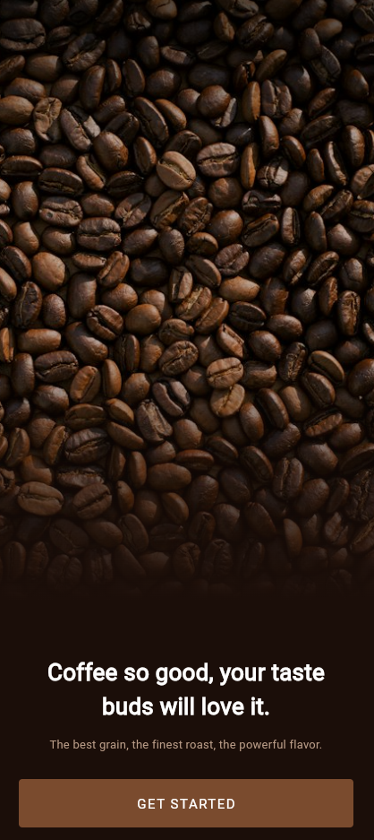
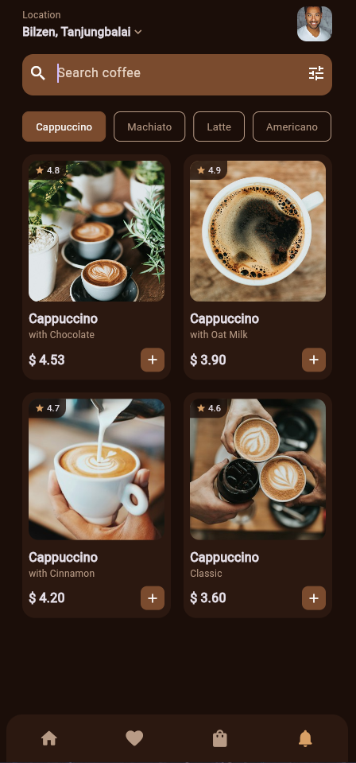
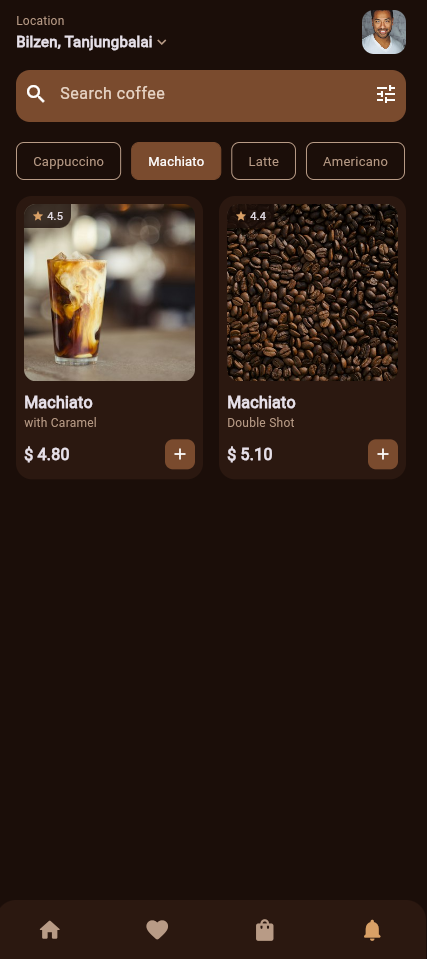

# Coffee Shop

Coffee Shop is a Flutter application for browsing and discovering coffee drinks. The app features a dark, elegant interface with a welcome screen and a home screen that displays a categorized coffee menu with prices, ratings, and live search.

## Screenshots

| Welcome Screen | Home - Cappuccino | Home - Machiato |
| :---: | :---: | :---: |
|  |  |  |

## Features

- Welcome screen with a full-screen background image, gradient overlay, tagline, and a Get Started action with a smooth fade transition.
- Home screen with a location header and user avatar.
- Search bar with a filter action, filtering coffee items by name or description in real time.
- Category tabs: Cappuccino, Machiato, Latte, and Americano, with a highlighted active state.
- Coffee grid displaying item images, ratings, names, descriptions, and prices.
- Add-to-cart action on each card with a confirmation snackbar.
- Bottom navigation bar with Home, Favorites, Cart, and Notifications tabs.
- Network images with loading indicators and fallback icons on failure.

## Getting Started

Prerequisites: Flutter SDK installed and configured. An internet connection is required to load images.

1. Navigate to the project directory:

```bash
cd coffee_shop
```

2. Install the dependencies:

```bash
flutter pub get
```

3. Run the application on a connected device or emulator:

```bash
flutter run
```

## Project Structure

```
lib/
├── main.dart                # Application entry point (starts at the welcome screen)
├── app_common.dart          # Shared color palette and reusable NetImage widget
├── welcome_screen.dart      # Welcome / Get Started screen
└── home_screen.dart         # Home screen with categories and coffee listings
```

## Color Palette

| Color | Hex | Usage |
| --- | --- | --- |
| Background | #1B0E09 | Primary app background |
| Card | #2B1810 | Card and bottom navigation background |
| Accent | #7A4B2E | Buttons and search bar |
| Muted | #B89B86 | Secondary text and borders |
| Highlight | #D9A066 | Ratings and selected navigation icons |

## Technology

- Flutter with Material 3 in dark theme
- Network images with loadingBuilder and errorBuilder
- PageRouteBuilder for custom fade transitions
- StatefulWidget for managing search, category selection, and navigation state

## Future Enhancements

- Product detail page
- Functional cart and favorites
- Local data persistence with shared_preferences
- Offline image fallback

## License

This project is provided for educational and demonstration purposes.
